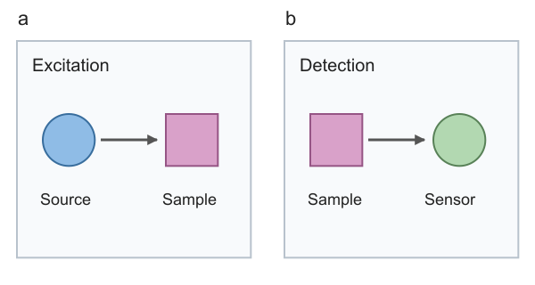

# paper-figure-reconstruction

将论文 PNG、截图或 PDF 中的科研示意图重建为**可编辑 SVG、真实 Blender 三维模型，以及可选的 Adobe Illustrator AI 文件**的 Codex Skill。

核心目标是保留原图的结构、布局和科学含义，通过修改源文件迭代提高相似度。图形分析由 Codex 完成；本项目不声称一个命令即可自动恢复任意图片，也不以 SSIM 高分代替科学正确性或“1:1”验收。



## 安装到 Codex

先克隆仓库到长期保留的开发目录，再安装 Skill：

```bash
git clone https://github.com/HyNlity/paper-figure-reconstruction.git
cd paper-figure-reconstruction
python3 scripts/install_skill.py
```

默认安装到 `~/.codex/skills/paper-figure-reconstruction/`；若设置了 `CODEX_HOME`，则安装到其 `skills/` 下。也可通过 `--target` 指定路径。安装器只复制 Skill 所需文件，不复制测试、论文素材或 Git 历史。

首次安装拒绝覆盖已有目录。更新时：

```bash
git pull --ff-only
python3 scripts/install_skill.py --update
```

更新前会完整备份现有 Skill 到同级 `skill-backups/`，备份不进入可发现的 `skills/` 目录。先在仓库修改和测试，再更新全局副本；不要长期只修改全局安装目录，否则后续同步容易丢失改动。安装器只管理本 Skill，不修改 Codex 配置或安装软件。

## 日常使用

在 Codex 中附上参考图或 PDF，调用：

> 使用 $paper-figure-reconstruction 重建这张论文图。三维部分必须真实建模，文字保持可编辑。交付 SVG、BLEND、可用时的 AI，以及视觉对比报告。

继续已有工作时，提供原始 `.blend` / SVG / AI 和需要保留的内容：

> 基于已有工程扩展 panel b，保持 panel a 不变。先核对相机、原子布局和旋转方向，再调整材质；验证 panel a 未发生变化。

不要求每张图都经过所有软件。纯二维图只需 SVG；真正的三维物体在 Blender 中建模。SVG/AI 可以包含自行渲染的 PNG，但该部分的几何编辑入口是 `.blend`。

## 工作流与产物

1. 阅读参考，识别 panels、文字、箭头、几何、遮挡和层级，记录不确定信息。
2. 建立 `figure-spec.json`：稳定组件 ID、归一化二维坐标、颜色、字体、三维参数和来源信息。
3. 生成原生 SVG 或 Blender Python 建模脚本，保存可编辑源文件。
4. 同尺寸渲染，生成叠图、差异图、SSIM 和轮廓距离，逐 panel 核对。
5. 定向修改布局、相机、几何、标注及材质，再重新渲染。
6. 可用时通过 Illustrator JSX 导入、分层并保存 AI；实际修改对象、重新打开并渲染，验证可编辑性。

典型交付：`figure.png`、`figure.svg`、三维工作的 `figure.blend`、可用时的 `figure.ai`、`figure-spec.json`、建模源码、环境清单、比较图与质量报告。论文原图不能充当重建纹理或成品素材；保留出处及版权标记，公开复用前核查论文图片许可。

## 环境与命令行工具

基础运行时：Python 3.9+、NumPy、Pillow；SVG 渲染需要 Node.js 和 Sharp。Blender、Illustrator、Poppler 按任务需要使用。MCP **不是必需依赖**，也不默认假设存在“官方 Illustrator MCP”。

先检查已有环境：

```bash
python3 scripts/figure.py doctor --out environment.json
```

如果已有 Codex 运行时包含这些库，直接使用其 Python / Node。只有确认需要新环境时，再自行选择以下安装方式；Skill 不会自动执行：

```bash
python3 -m venv .venv
source .venv/bin/activate
python -m pip install -r requirements.txt
npm install
```

用原创示例运行二维最小流程：

```bash
python scripts/figure.py svg --spec examples/two-panel/figure-spec.json --out output/figure.svg
node scripts/render_svg.cjs output/figure.svg output/figure.png
python scripts/figure.py audit-svg --svg output/figure.svg
python scripts/figure.py compare --reference examples/two-panel/reference.png --candidate output/figure.png --spec examples/two-panel/figure-spec.json --out output/comparison
```

Sharp 解析顺序：`PFR_NODE_MODULES`、普通 Node 模块查找、已有 Codex bundled runtime。`PFR_NODE_MODULES` 应指向包含 Sharp 的 `node_modules` 目录。

三维与 Illustrator 入口：

```bash
python scripts/figure.py blender --spec figure-spec.json --out output/3d --dry-run
python scripts/figure.py illustrator --spec figure-spec.json --svg output/figure.svg --out output/ai
```

前者输出待审批执行的 Blender 命令，不绕过沙盒；复杂几何用 `--script rebuild.py` 指定自定义建模脚本。后者生成 `import.jsx` 和矢量导入文件，不自动启动 Illustrator。执行方法见 [应用适配说明](references/applications.md)。

## 已知问题与处理方式

| 现象 | 处理 |
|---|---|
| 本机 Blender 4.5.10 在沙盒内 Metal 检测时崩溃 | 按环境要求申请沙盒外执行；CPU 渲染不能避开启动检测；不要反复重试或重置偏好设置 |
| Illustrator 中箭头只剩头部 | 已改为显式原生箭杆和头部路径，避免 SVG marker 导入问题 |
| 含内嵌图像的 SVG 导入 Illustrator 长时间占用 | 适配器先导入矢量占位，再原生置入/嵌入自建 PNG；超时后先检查进程，不立即重复执行 |
| 文字出现方框或字体替代 | 核对字体和具体字形；数学符号必要时单独用可编辑路径，保留其他原生文字 |
| SSIM 很高但缺少关键箭头 | 同时检查 panel、局部结构与科学语义；指标不是完整性证明 |
| 两张预览尺寸不同 | 显式统一画布、裁剪并记录转换；比较器不会偷偷缩放或变形对齐 |
| 密集大图的轮廓比较较慢 | 当前采用精确分块最近距离；先对明确记录尺寸的预览/局部区域诊断，再做最终尺寸比较 |

这些是实际遇到并验证的具体问题，不代表对所有软件版本和平台的保证。当前真实应用测试环境为 macOS、Blender 4.5.10 LTS、Illustrator 30.4.0。

## 遇到问题后，如何让我继续维护

建议在 [Issues](https://github.com/HyNlity/paper-figure-reconstruction/issues) 新建问题，使用“Bug report”模板，记录软件版本、最小复现步骤、期望与实际结果、错误日志和允许分享的参考/输出。没有合适的公开素材时，只描述问题或提供原创最小示例，不上传未授权论文和未公开研究资料。

之后可直接在 Codex 中说：

> 请维护 [paper-figure-reconstruction](https://github.com/HyNlity/paper-figure-reconstruction)，修复 issue #编号。先复现，再修改源代码并加入回归测试；验证通过后提交。若需要更新本机全局 Skill，请先核对并备份现有副本。

没有 issue 时也可以说：

> 使用 paper-figure-reconstruction 时，Illustrator 导出的箭头丢失。参考文件在……，预览在……，版本为……。请在仓库修复，并说明根因、验证结果和仍未解决的问题。

每次维护应明确：复现证据 → 根因/假设 → 最小修改 → 回归测试 → 实际应用验证 → 提交与安装同步。仓库中的 [AGENTS.md](AGENTS.md) 给后续维护者保留了这些约束；需要外部应用的验证不能用纯 Python 测试冒充。

## 测试与证据边界

```bash
python -m unittest discover -s tests -v
```

测试覆盖 SVG 原生文字/箭头、错误输入、比较器对平移和缺失元素的响应，以及安装/更新时的备份行为。不会启动 Blender / Illustrator，也不会安装依赖。

初始人工与应用验证还包括：

- 原创二维图：SSIM 0.910550 → 0.994837，轮廓平均误差 0.418104 → 0.102396 px；8 个原生文字；原生 AI 文字/箭杆编辑后另一 panel 像素不变。
- 既有晶体工程：修改真实几何、保存后重新打开、迁移目录重建通过；原工程保持不变。与论文参考的基线 SSIM 约 0.704800，**未达到 1:1**。
- Illustrator 混合图：成功置入自行渲染的 PNG，0 外链；真实三维结构在 BLEND 中编辑。

仓库仅包含可公开的原创二维示例；论文参考、私人路径和大型本地工程不随仓库发布。两例验证的是工作流与可编辑性，不是任意论文的自动识别能力。

## 项目结构

```text
SKILL.md                  Codex Skill 入口
agents/openai.yaml        Skill 展示信息
scripts/                  环境检查、SVG、比较、Blender、Illustrator、安装工具
references/               spec、应用适配、验收与参考项目审查
examples/two-panel/       原创参考、spec、SVG 与预览
tests/                    无需桌面应用的回归测试
.github/ISSUE_TEMPLATE/   问题反馈模板
AGENTS.md                 后续 Codex 维护约定
```

参考项目的能力、依赖和许可证审查见 [project-review.md](references/project-review.md)。本项目当前没有复制其源码或字体；第三方代码许可不等于论文图像的使用许可。
