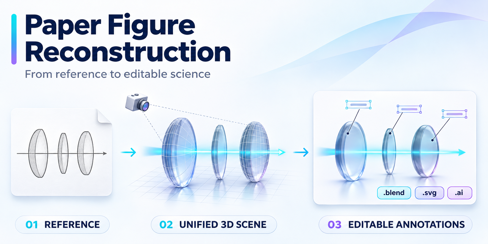
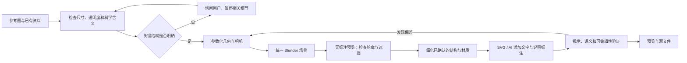
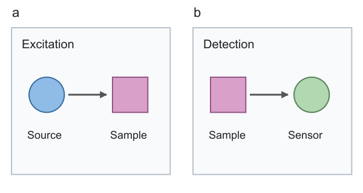

# paper-figure-reconstruction



**把论文示意图，重建成可以继续修改的科研绘图工程。**

一个面向 Codex 的 Skill：从 PNG、截图或 PDF 分析结构与科学含义，在 Blender 中建立真实几何，再用 SVG／Illustrator 添加可编辑文字、公式和标注。交付预览图，也保留建模参数、源文件和验证记录。

[快速开始](#quick-start) · [工作方式](#workflow) · [可编辑范围](#deliverables) · [验证与边界](#validation) · [反馈问题](https://github.com/HyNlity/paper-figure-reconstruction/issues)

<sub>封面由图像模型生成，仅解释项目流程；不是本 Skill 的实测复现结果或光学模拟。生成说明与提示词见 [封面来源记录](assets/readme-cover.provenance.json)。</sub>

## 为什么使用它

| 能力 | 具体做法 |
|---|---|
| **统一的三维空间关系** | 需要相互遮挡、穿透或共享视点的晶体、光束、偏振螺旋等，在同一 Blender 场景中建模和渲染 |
| **先弄清楚画的是什么** | 放大参考并查阅已有图注；材料、晶格或箭头含义仍不明确时，先询问用户，暂停相关细节 |
| **保留可编辑源文件** | 三维几何保存在 `.blend`；文字、公式和说明箭头保留为 SVG／AI 原生对象 |
| **从源头修正偏差** | 用共享单元、厚度、间距、旋转轴、转角及相机参数调整结构，再重新渲染 |
| **分别检查视觉与科学含义** | 对比图和局部指标辅助定位偏差，同时核对结构、遮挡、方向、旋向及标注 |

Codex 负责理解参考、确认歧义和编写复杂几何；本地脚本负责环境检查、生成、渲染、比较与导出。原生文字数量或图像相似度不能单独证明复现正确。

<a id="quick-start"></a>
## 快速开始

### 1. 安装 Skill

```bash
git clone https://github.com/HyNlity/paper-figure-reconstruction.git
cd paper-figure-reconstruction
python3 scripts/install_skill.py
```

默认安装到 `$CODEX_HOME/skills/paper-figure-reconstruction`；未设置 `CODEX_HOME` 时使用 `~/.codex/skills/paper-figure-reconstruction`。安装器只复制本 Skill，不安装桌面软件、不修改 MCP 或 Codex 配置。

更新已有安装前，先核对本地修改：

```bash
git pull --ff-only
python3 scripts/install_skill.py --update
```

`--update` 会先完整备份旧版到 `skills/` 同级的 `skill-backups/`，再替换安装副本。若仓库有未提交修改，应先保留和处理，避免覆盖自己的维护工作。

### 2. 提供参考图并发起任务

在 Codex 中附上图像、PDF 指定页，或已有工程，并说明想保留的部分。例如：

> 请使用 paper-figure-reconstruction 复现这张论文示意图。相互关联的三维结构和光束放在同一个 Blender 场景，最后添加可编辑文字与标注。如果看不清材料或晶格结构，先向我确认。先给我看无标注的整体预览，再细化；交付 PNG、SVG 和 Blender 源文件，可用时提供 AI。

也支持纯二维示意图，以及已有 SVG／BLEND 工程的局部修改。纯二维任务不需要额外制作 Blender 文件。

### 3. 检查环境

```bash
python3 scripts/figure.py doctor --out environment.json
```

| 组件 | 用途 |
|---|---|
| Python 3.9+、NumPy、Pillow | 本地脚本、图像比较与检查 |
| Node.js、Sharp | SVG 转 PNG |
| Blender | 实际三维建模与渲染；纯二维任务可不使用 |
| Adobe Illustrator | 可选的 AI 原生文字、路径及嵌入渲染导出 |
| Poppler | PDF 输入的页面渲染与文本提取 |

优先复用已有环境。需要独立环境时，可自行安装项目依赖：

```bash
python3 -m venv .venv
source .venv/bin/activate
python -m pip install -r requirements.txt
npm install
```

MCP 不是必需依赖。已安装应用、配置了连接和连接当前可用，是不同的事实；工具会分别检查，不默认存在“官方 Illustrator MCP”。

<a id="workflow"></a>
## 工作方式



**三维对象交给 Blender。** 用同一个单元建立重复结构，明确厚度、间距、旋转轴与转角，再调整相机。需要穿过晶体的光束、偏振螺旋和物理场矢量与晶体共处一个场景；不按截图角点逐件拼接，也不在 SVG 中另外画一束光来代替真实遮挡关系。独立面板可以分别建模。

**说明标注交给矢量工具。** 文字、公式、角度辅助线、尺寸箭头和说明性矢量保留为原生对象。纯二维图直接采用矢量流程，不强制经过上面的三维分支。

**不清楚的科学信息先确认。** “二维材料”并不能确定材料种类、晶格或原子排列。模糊的重复纹理不能擅自替换成箭头、三角凸起或装饰图案；先查看已有资料，仍无法确认就具体询问，同时可以继续明确的整体几何。

用户要求审核当前结果时，先交付现有预览与可用源文件，并说明未完成项；不会为了额外导出或完整验证而延迟审核。

<a id="deliverables"></a>
## 交付什么，在哪里修改

| 文件 | 内容与编辑入口 |
|---|---|
| `figure.png` | 最终或阶段预览，便于查看与比较 |
| `figure.blend` | 三维几何、材质、相机和灯光；在这里修改真实空间结构 |
| `figure.svg` | 原生文字、公式、路径及整体三维渲染；三维部分是位图，不是矢量网格 |
| `figure.ai`（可用时） | Illustrator 原生标注与嵌入渲染；实际三维几何仍在 BLEND 中 |
| `figure-spec.json`、建模源码 | 组件、证据、假设、几何参数和重建逻辑 |
| 环境清单、比较图与质量报告 | 软件版本、验证结果、未完成检查和残余偏差 |

纯二维任务无需 BLEND。AI 可用性以实际导出结果为准。手工修改 AI 或 Blender 不会自动回写 spec／脚本，若希望下次重建保留修改，需要同步维护源参数。

## 原创二维示例与命令行

下图是仓库内可运行的原创示例，展示文字、箭头和两个独立 panel，区别于顶部的概念封面。



```bash
python scripts/figure.py svg --spec examples/two-panel/figure-spec.json --out output/figure.svg
node scripts/render_svg.cjs output/figure.svg output/figure.png
python scripts/figure.py audit-svg --svg output/figure.svg
python scripts/figure.py compare --reference examples/two-panel/reference.png --candidate output/figure.png --spec examples/two-panel/figure-spec.json --out output/comparison
```

Sharp 解析顺序为 `PFR_NODE_MODULES`、普通 Node 模块查找、已有 Codex bundled runtime。`PFR_NODE_MODULES` 应指向包含 Sharp 的 `node_modules` 目录。

三维与 Illustrator 入口：

```bash
python scripts/figure.py blender --spec figure-spec.json --out output/3d --dry-run
python scripts/figure.py blender --spec figure-spec.json --out output/3d --script rebuild.py --dry-run
python scripts/figure.py illustrator --spec figure-spec.json --svg output/figure.svg --out output/ai
```

Blender 命令先用 `--dry-run` 查看，再按运行环境要求执行；自定义建模脚本使用 `--script`。Illustrator 入口生成 JSX 与矢量导入文件，不自动启动应用。执行方法与已知限制见 [应用适配说明](references/applications.md)。

<a id="validation"></a>
## 验证与已知边界

```bash
python -m unittest discover -s tests -v
```

当前四项自动测试覆盖：原生 SVG 文字与箭头及实际编辑、错误输入与参考位图拒绝、比较器对平移和缺失结构的响应、安装更新的备份行为。它们不会启动 Blender／Illustrator，也不等同于三维建模或科学语义验证。

本次文档更新（2026-11-03）已通过官方 Skill 格式校验、上述四项测试、原创二维示例生成／渲染／SVG 审计／比较，以及 README 本地链接检查。本次未修改渲染器或应用适配代码，也未重新运行桌面应用测试。

历史应用检查已验证部分二维对象编辑、三维几何编辑与重建、混合图置入流程，具体适用环境为 macOS、Blender 4.5.10 LTS 和 Illustrator 30.4.0。不能据此承诺所有版本兼容。

近期扭转材料案例改善了**统一三维建模与整体轮廓**，但内部结构仍被错误表现为箭头状凸起；这是待确认和修正的材料表达问题，不是完整复现成功。经验与验收方法见 [质量检查](references/quality.md)。

| 已知情况 | 当前处理与验证要求 |
|---|---|
| 本机 Blender 4.5.10 在受限环境内的 Metal 启动检测崩溃 | 经批准在受限环境外启动；CPU 渲染不能避开启动检测，不反复重试或重置偏好设置 |
| Illustrator 导入 SVG marker 后箭杆丢失 | 使用显式箭杆与头部路径，并检查导出预览 |
| 内嵌图像 SVG 导入 Illustrator 长时间占用 | 使用矢量占位和原生置入／嵌入；超时先检查状态，不重复启动同一工作 |
| SVG 分组提升为图层后，遮挡顺序改变 | 现有适配器的分组处理仍需按图核对，不能仅凭对象计数判定正确 |
| 希腊字母、上下标或矢量符号异常 | 检查编码、字体及实际导出；Unicode 转义与独立定位文字／路径是候选处理方法，未在该失败案例中完成修复验证 |
| 透明背景掩盖标注，或比较图尺寸不一致 | 先在白底检查完整参考；保留真实尺寸与纵横比，明确记录缩放／裁剪，不拉伸参考图凑指标 |

相似度和轮廓距离用于定位偏差；完整性、旋向、材料身份及晶格拓扑必须单独检查。无法从单张图片恢复不可见的精确结构，曲线数据提取也不在本 Skill 的目标内。

## 维护与参考

问题反馈请使用 [Issues](https://github.com/HyNlity/paper-figure-reconstruction/issues)，附上版本、最小复现、期望与实际结果，以及允许公开的素材。也可以在 Codex 中说：

> 请维护 paper-figure-reconstruction，修复 issue #编号。先复现，再修改源代码并加入必要回归测试；说明实际验证结果和剩余问题。更新全局 Skill 前请核对并备份现有副本。

| 文档 | 内容 |
|---|---|
| [SKILL.md](SKILL.md) | Codex 的任务执行规则 |
| [figure-spec 约定](references/spec.md) | 坐标、组件、场景参数和证据记录 |
| [应用适配](references/applications.md) | Blender／Illustrator 执行与已知问题 |
| [质量检查](references/quality.md) | 比较方法、编辑性验证与案例经验 |
| [AGENTS.md](AGENTS.md) | 仓库维护约束 |
| [参考项目审查](references/project-review.md) | 第三方能力、依赖与许可证边界 |

README 的信息组织参考了 [Manim](https://github.com/ManimCommunity/manim) 的演示与入门顺序，以及 [Best-README-Template](https://github.com/othneildrew/Best-README-Template) 的导航结构；未复制其封面、标志或示例代码。

论文原图用于观察和比较，不能充当重建纹理或成品素材。保留出处与版权标记，公开复用前核查许可；仓库不发布私人路径、未授权论文图片或大型私人工程。顶部生成封面只用于项目介绍，科学复现流程仍以真实几何和原生标注为准。
